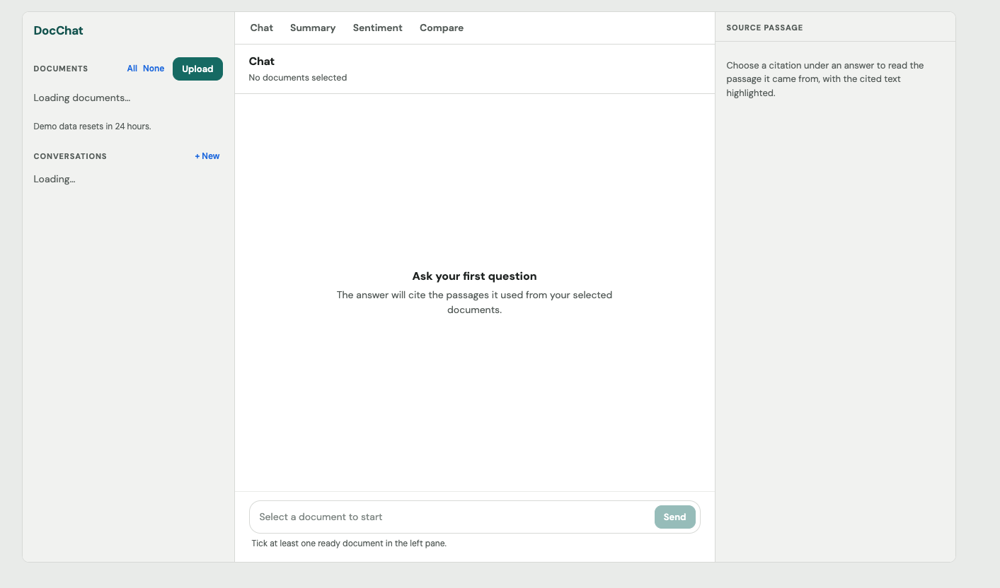

<!-- portfolio: section=ai-rag -->
# DocChat RAG

Chat with your own documents. Upload files and ask questions: answers are grounded in the passages retrieved from your selected documents and cite their sources, and clicking a citation shows the exact passage with the cited text highlighted. Also summarizes, runs sentiment analysis and compares documents, through a bounded LangGraph agent.

**Live demo:** https://rag-docchat-tool.vercel.app

Keywords: `ai-rag` · RAG · embeddings · vector search · LangGraph · LLM · document Q&A

## Backend

Document-chat RAG backend: upload documents, summarize, ask with citations, compare, query tables, through a bounded LangGraph agent. Spec: [docs/spec.md](docs/spec.md). Run `uv sync`, then `uv run uvicorn app.main:app --app-dir src/backend`.

## Eval results (mock)
`uv run python -m evals.run --mock --check` (offline, ~3 s, $0). **These numbers are `mock`: a scripted stand-in model with fake embedder and reranker. They prove the pipeline is wired and measured, not model quality.** Details: [docs/architecture/evals.md](docs/architecture/evals.md).

| metric (mock) | value | threshold | pass |
| --- | --- | --- | --- |
| recall@5 | 0.786 | >= 0.8 | NO |
| MRR | 0.81 | >= 0.6 | yes |
| faithfulness | 1.0 | >= 0.85 | yes |
| relevance | 0.89 | >= 0.8 | yes |
| citation_correct | 0.88 | >= 0.9 | NO |
| agent task_success | 0.80 | >= 0.8 | yes |
| avg steps | 7.85 | <= 8 | yes |
| injection block rate | 1.0 (11/11) | >= 0.9 | yes |
| p95 latency (mock) | 0.015 s | <= 8 s | yes |
| max USD per request (mock) | 0.011 | <= 0.05 | yes |

Two misses (recall@5, citation_correct) are reported as measured; thresholds were not changed. See T-023 Findings.
